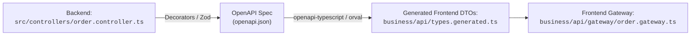

# 🤝 Frontend ⟷ Backend Contracts Baseline

In medium and large projects, a major point of maintenance friction is **type divergence between backend API payloads and frontend expectations**.

---

## 1. Common Anti-Patterns

1. **Manual Type Duplication in Frontend:** Frontend engineers manually type a TypeScript interface (`OrderRawDTO`). When a backend engineer renames a field, the frontend breaks silently at runtime.
2. **Direct Server Entity Imports in Frontend:** Frontend imports domain classes directly from the backend repository. This leaks server dependencies (database drivers, ORMs, secrets) into the client bundle.

---

## 2. Pragmatic Corporate Standard: Contract-First via OpenAPI

The Backend exports an OpenAPI specification (or Zod/JSON schema) generated from its controllers and DTOs. The Frontend generates its transport DTOs automatically during build:



---

## 3. How `business/api/gateway/order.gateway.ts` Consumes Contracts

The Frontend Gateway never guesses response structures. It binds strictly to generated API contracts:

```typescript
import type { IHttpFacade } from '../../../config/contracts/interfaces/http-facade.interface.js';
import type { paths } from './types.generated.js';

type OrderApiResponse = paths['/api/orders']['get']['responses']['200']['content']['application/json'];

export class OrderApiGateway {
  constructor(private readonly http: IHttpFacade) {}

  async fetchOrders(): Promise<OrderApiResponse> {
    const response = await this.http.get<OrderApiResponse>('/api/orders');
    return response.data;
  }
}
```

---

## ⚖️ Trade-offs

- **What Scales:**
  - **Bulletproof Refactoring:** Renaming a backend field triggers compile-time TypeScript errors during frontend CI/CD.
  - Zero manual interface duplication.
- **What Does NOT Scale:**
  - Enforcing this in **Tier 1 (Small)**: for 1-developer short-lived prototypes, simple manual interfaces are more than sufficient.
