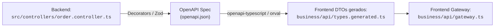

# 🤝 Diretrizes de Contratos Front-End ⟷ Back-End (Contracts Baseline)

Em projetos de médio e grande porte, um dos maiores problemas de manutenção é o **descompasso de tipos entre o que o Backend retorna e o que o Frontend espera**.

---

## 1. O Problema: Acoplamento Frágil ou Ilusão de Segurança

Existem duas abordagens ruins muito comuns no mercado:
1. **Tipos Manuais Duplicados no Front:** O dev do Front cria uma interface TypeScript na mão (`OrderRawDTO`). Quando o dev do Back altera o nome de um campo no banco, o Front quebra em tempo de execução sem nenhum aviso de compilação.
2. **Importação Direta de Classes de Domínio do Back no Front:** O Front importa entidades do Back. Isso vaza dependências internas do servidor (banco, ORM, segredos) para o bundle do cliente.

---

## 2. A Solução Corporativa Pragmática: Contract-First via OpenAPI / Schemas

O Backend expõe uma especificação OpenAPI (Swagger) ou schema Zod/JSON gerado automaticamente a partir de seus Controllers e DTOs. O Frontend gera seus tipos de transporte automaticamente no build:



---

## 3. Como o `business/api/gateway.ts` consome esses tipos

O Gateway do Frontend nunca adivinha o formato da resposta. Ele utiliza os tipos gerados a partir do contrato da API:

```typescript
// Exemplo de integração no business/api/gateway.ts
import { HttpFacade } from '../../config/http.facade.js';
// Tipo gerado automaticamente a partir da especificação do backend:
import type { paths } from './types.generated.js';

type OrderApiResponse = paths['/api/orders']['get']['responses']['200']['content']['application/json'];

export class OrderApiGateway {
  constructor(private readonly http: HttpFacade) {}

  async fetchOrders(): Promise<OrderApiResponse> {
    const response = await this.http.get<OrderApiResponse>('/api/orders');
    return response.data;
  }
}
```

---

## ⚖️ Trade-offs

- **O que escala:**
  - **Refatorações à prova de balas:** Se um campo da API for renomeado no backend, o TypeScript do Frontend aponta o erro de compilação imediatamente durante o `npm run build` no CI/CD.
  - Zero duplicação manual de interfaces.
- **O que NÃO escala:**
  - Tentar forçar isso no **Tier 1 (Small)**: em projetos de 1 pessoa com vida útil curta, interfaces manuais simples em um arquivo são mais que suficientes.

